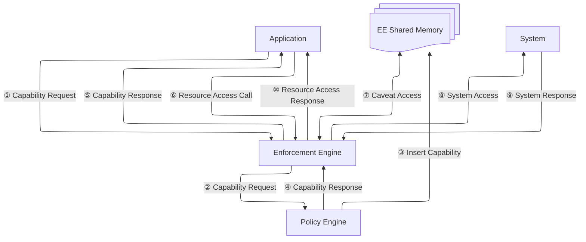
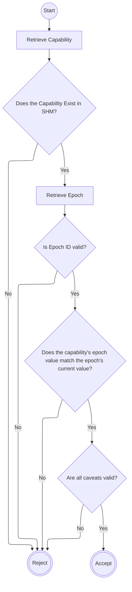

# Enforcement Engine

The Enforcement Engine enforces a boundary between applications running in an Application Environment and system resources. It gates access to these resources based on capabilities that are governed by Aranya policy.

## Architectural Diagram of Capability Acquisition and Use

## Application Environment

Each Application runs in an Application Environment that manages the running application. It knows its Instance ID and provides the [Resource Access Interface](#resource-access-interface) to the application.

## Application Mapping

Each application in the system has an Application ID created by the developer and provided in the app's metadata. On instantiation, a _running_ application is given an Instance ID that uniquely identifies the running application (this identifier could be based on a process identifier, a memory address, etc.; it doesn't matter to the Enforcement Engine). The Enforcement Engine keeps a mapping of Application IDs to Instance IDs so that the Policy Engine does not need to be aware of the runtime details of applications. This does imply that permissions cannot be granted to particular _instances_ of an application. They can only be granted to an application as a class.

The mechanism of populating this mapping is TBD.

## Capability Requests

Before an application can access a system resource, it must request a capability for that resource. A capability grants access to a particular resource (e.g. a sensor, a message bus) via a particular method (e.g. read, write, delete). The new capability is inserted into the [SHM](#shared-memory-shm) shared by the Enforcement Engine and Policy Engine.

### Capability Request

| Field | Type | Description |
|-|-|-|
| Resource ID | u64 | The resource the capability operates on |
| Operation ID | u64 | The particular operation the application wants to use on the resource |

### Capability Response

The capability response includes the status of the grant, and if successful, a copy of the granted capability (see [Capability](#capability) in the SHM section below).

| Field | Type | Description |
|-|-|-|
| Success | boolean | Whether the call succeeded |
| Capability | [Capability](#capability) | The capability, if granted, otherwise empty |

## Resource Access Interface

The Application accesses resources through an interface in the Application Environment. The Enforcement Engine receives these accesses, evaluates them against the active capabilities, and, if allowed by the capabilities, executes them on behalf of the Application.

"Resource" in this context is meant to be abstract, and represents anything the system provides to an application.

Each operation is identified by a number and has a parameter list. The parameter list contains values which are not interpreted by the enforcement engine, but are checked via caveats (see [Caveats](#caveats) below). The access also includes the Capability ID which allows the call. The Application Environment attaches the Instance ID, which identifies the Application making the call.

| Field | Type | Description |
|-|-|-|
| Operation ID | u32 | The operation being requested |
| Parameter List | list[[Value](#call-values-and-serialization)] | The arguments to the access |
| Capability ID | u64 | The Capability for the system call |
| Instance ID | u32 | Which Application is making the request |

Some Operation ID numbers will be reserved for Capability management itself, allowed with a null Capability ID, so that the Enforcement Engine can provide this to the Application without a separate management interface.

### Call Values and Serialization

A Value in the Parameter List can be either a 64-bit integer or a length-prefixed byte string. To support this and future Value types, these parameters are serialized (method TBD).

| Variant | Type | Description |
|-|-|-|
| Integer | u64 | A numerical type, enumeration, or pointer |
| Bytes | list[u8] | An array of bytes or character string |

## Shared Memory (SHM)

The shared memory segment is shared between the Policy Engine and the Enforcement Engine. It contains information about currently authorized capabilities and their caveats, as well as the currently active epochs. It is written to by the Policy Engine and read by the Enforcement Engine.

### Capability

Each Capability in the SHM describes a grant given to a running application.

| Field | Type | Description |
|-|-|-|
| Capability ID | u64 | Unique identifier for this granted capability |
| Application ID | list[u8] | A character string uniquely identifying the application |
| Resource ID | u64 | The resource this Capability applies to |
| Method ID | u64 | The method on the resource |
| Epoch ID | u64 | The identifier of the epoch this Capability is granted under |
| Epoch value | u64 | The current value of the Epoch identified by Epoch ID |
| Caveats | list[[Caveat](#caveat)] | List of Caveats for this Capability |

For efficiency, the Capability ID may embed information that allows quick lookup in the Enforcement Engine (e.g. a slot index in the SHM table). So in practice, the Capability ID might be a tuple of integers. The unguessability of the Capability ID must be maintained, though, so that they cannot be easily spoofed.

#### Caveat

Each Caveat evaluates one resource access parameter against a set of possible filters. Caveats have these types:

| No. | Operation | Type | Implementation |
|-|-|-|-|
| 0 | Masked Equality | Integer | `(argument ^ A) & B == 0` |
| 1 | Range | Integer | `argument >= A && argument < B` |
| 2 | Bitwise flag AND | Integer | `argument & A == A` |
| 3 | Bitwise flag OR | Integer |`argument & A > 0` |
| 4 | Token Bucket | Integer (Token Bucket) | `A` is the per-call cost, `B` is the token bucket cap, and `C` is the signed number of tokens in the bucket (increasing at a rate of 1 per time step). On evaluation, tokens are added to the bucket based on the last time the bucket was evaluated , capped by `B` (`C = min(C + time_since(ts), B);`). If `A` is greater than `C`, `A` is subtracted from `C` and the evaluation succeeds. Otherwise, evaluation fails. |
| 5 | Bytes Match | Bytes | `len(argument) == len(X) && argument == X` |
| 6 | Bytes Prefix | Bytes | `substr(argument, len(X)) == X` |

The Caveat has these base fields:

| Field | Type | Description |
|-|-|-|
| Argument number | u8 | The argument position this Caveat applies to |
| Caveat Operation | u32 | The operation applied in this Caveat |

Integer values Caveats have these fields:

| Field | Type | Description |
|-|-|-|
| Caveat Value (`A`) | i64/u64 | A value used by the operation |
| Caveat Value (`B`) | i64/u64 | A second value used by the operation |

The Token Bucket Caveat additionally has these fields on top of Integer fields:

| Field | Type | Description |
|-|-|-|
| Caveat Value (`C`) | i64/u64 | A third value used by the operation |
| Caveat Timestamp (`ts`) | u64 | Last time the Caveat was evaluated |

Bytes Caveats have this field:

| Field | Type | Description |
|-|-|-|
| Caveat Bytes Match (`X`) | list[u8] | Value to match against for Bytes values |

### Epoch

An Epoch gates Capabilities globally. Incrementing an Epoch's value immediately invalidates all Capabilities granted under that Epoch.

| Field | Type | Description |
|-|-|-|
| Epoch ID | u64 | Identifies the epoch |
| Epoch value | u64 | The value of the epoch |

## Capability Evaluation

When the Enforcement Engine receives a resource access, it first looks up the capability ID in the SHM. If the capability ID is not present, the call is rejected. Once the capability is retrieved, it is evaluated. The epoch ID for the capability is looked up in SHM. If the epoch ID is not present, the call is rejected. If the epoch value in the caveat is not equal to the current epoch value, the call is rejected. Then all caveats are evaluated, and if any fail, the call is rejected.

Caveats place additional constraints on the validity of a capability, as described in [Caveats](#caveats) above. Each Caveat is evaluated in turn, as described by its operation.

Once all checks pass, the resource access is accepted and passed to the system. The response from the system is passed back through the Evaluation Engine and ultimately back to the application.