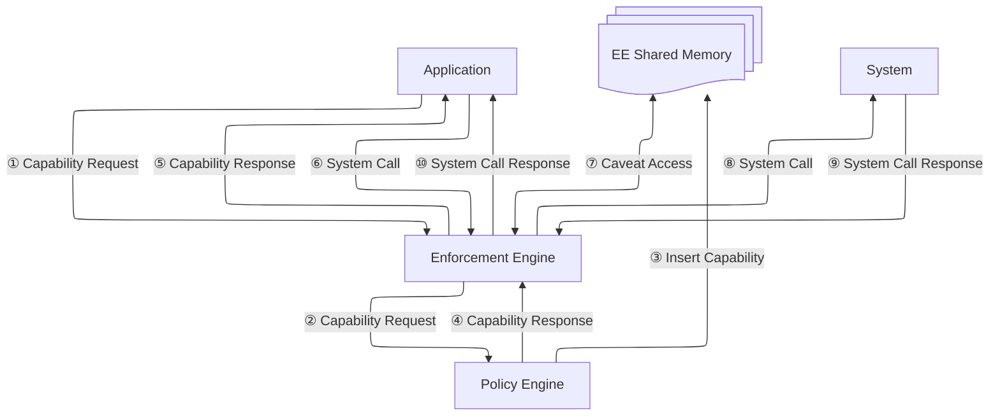
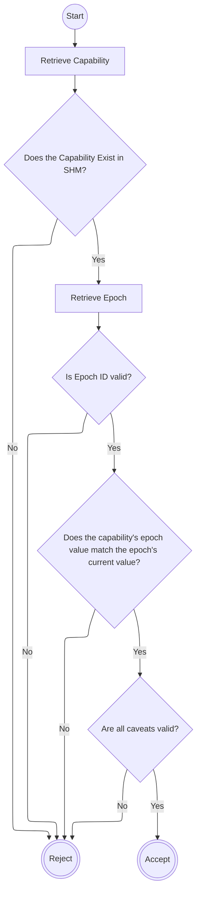

# Enforcement Engine

The Enforcement Engine enforces the boundary between applications running in an Application VM and system resources. It gates access to these resources based on capabilities that are governed by Aranya policy.

## Architectural Diagram of Capability Acquisition and Use

## Application Mapping

Each application in the system has an Application ID created by the developer and provided in the app's metadata. On instantiation in the VM, a _running_ application is given a VM ID that uniquely identifies the running application (this identifier could be based on a process identifier, a memory address, etc.; it doesn't matter to the Enforcement Engine). The Enforcement Engine keeps a mapping of Application IDs to VM IDs so that the Policy Engine does not need to be aware of the runtime details of applications. This does imply that permissions cannot be granted only to particular _instances_ of an application. They can only be granted to an application as a whole.

The mechanism of populating this mapping is TBD.

## Capability Request

Before an application can access a system resource, it must request a capability for that resource. The new Capability is inserted into the [SHM](#shared-memory-shm) shared by the engine and System Service Workers.

### Capability Request

| Field | Type | Description |
|-|-|-|
| System Call number | u64 | The particular system call the application wants to access |
| Parameter list | list[Parameter] | Additional information narrowing the call scope |

The Parameter list fixes certain system call arguments (e.g. to access a particular device in a class of devices or to use it in a particular mode). The Aranya policy can use this information when deciding whether or not to grant the capability.

#### Parameter

| Field | Type | Description |
|-|-|-|
| Argument number | u8 | Which argument the value is for |
| Argument value | u64 | The value of the argument |

### Capability Response

The capability response only includes a capability ID on success. The further details of this Capability is stored in Shared Memory, which can be queried by the application.

| Field | Type | Description |
|-|-|-|
| Success | boolean | Whether the call succeeded |
| Capability ID | u64 | The capability ID, if granted, otherwise zero |

## VM System Calls

The Application VM makes calls to the system through a provided call interface (design TBD). The call includes both the information about the call, and the capability the application holds for that call. The Enforcement Engine receives these calls, evaluates the active capabilities for those calls, and, if allowed by the capabilities, executes them on behalf of the Application.

It is not required or intended by this specification that these calls must map to real operating system calls. They may be routed to virtual devices, memory ranges, or anything else.

Each system call is identified by a number and has a parameter list. The parameter list contains integers which are not interpreted by the enforcement engine, but are checked via caveats (see [Caveats](#caveats) below). The system call also includes the Capability ID which allows the call. The VM also attaches the VM ID, which identifies the VM making the call.

| Field | Type | Description |
|-|-|-|
| System Call number | u32 | The call being requested |
| Parameter List | list[u64] | The arguments to the call |
| Capability ID | u64 | The Capability for the system call |
| VM identifier | u32 | Which VM is making the request |

Some system call numbers will be reserved for Capability management itself, so that the Enforcement Engine can provide those to the VM without a second call interface.

## Shared Memory (SHM)

The shared memory segment is shared between the Policy Engine and the Enforcement Engine. It contains information about currently authorized capabilities and their caveats, as well as the currently active epochs. It is written to by the Policy Engine and read by the Enforcement Engine.

### Capabilities

Each Capability in the SHM describes a grant given to a running application.

| Field | Type | Description |
|-|-|-|
| Capability ID | u64 | Unique identifier for this granted capability |
| Application ID | list[u8] | A string uniquely identifying the application |
| Epoch ID | u64 | The identifier of the epoch this Capability is granted under |
| Epoch value | u64 | The current value of the Epoch identified by Epoch ID |
| System Call number | u64 | The system call this Capability applies to |
| Caveats | list[Caveat] | List of Caveats for this Capability |

#### Caveats

Each Caveat evaluates one system call argument against a set of possible filters. The Caveat has this form:

| Field | Type | Description |
|-|-|-|
| Argument number | u8 | The argument position this Caveat applies to |
| Caveat Operation | u32 | The operation applied in this Caveat |
| Caveat Value (`A`) | i64/u64 | A value used by the operation |
| Caveat Value (`B`) | i64/u64 | A second value used by the operation |
| Caveat Value (`C`) | i64/u64 | A second value used by the operation |
| Caveat Timestamp (`ts`) | u64 | Last time the Caveat was evaluated |

Caveats have these types:

| No. | Operation | Description |
|-|-|-|
| 0 | Masked Equality | `(argument ^ A) & B == 0` |
| 1 | Range | `argument >= A && argument < B` |
| 2 | Bitwise flag AND | `argument & flags == flags` |
| 3 | Bitwise flag OR | `argument & flags > 0` |
| 4 | Token Bucket | `C = min(C + time_since(ts), B); C > 0; C -= A`. `A` is the per-call cost, `B` is the token bucket cap, and `C` is the signed number of tokens in the bucket (increasing at a rate of 1 per time step) |

### Epochs

An Epoch gates Capabilities globally. Incrementing an Epoch's value immediately invalidates all Capabilities granted under that Epoch.

| Field | Type | Description |
|-|-|-|
| Epoch ID | u64 | Identifies the epoch |
| Epoch value | u64 | The value of the epoch |

## Capability Evaluation

When the Enforcement Engine receives a call, it first looks up the capability ID in the SHM. If the capability ID is not present, the call is rejected. Once the capability is retrieved, it is evaluated. The epoch ID for the capability is looked up in SHM. If the epoch ID is not present, the call is rejected. If the epoch value in the caveat is not equal to the current epoch value, the call is rejected. Then all caveats are evaluated, and if any fail, the call is rejected.

Caveats place additional restraints on the validity of a capability, as described in [Caveats](#caveats) above. Each Caveat is evaluated in turn, as described by its operation.

Once all checks pass, the sytem call is accepted and passed to the system. The response from the call is passed back through the Evaluation Engine and ultimately back to the application.